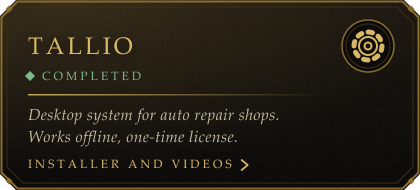
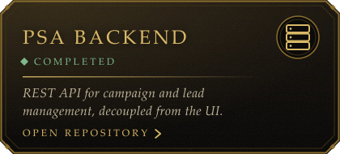
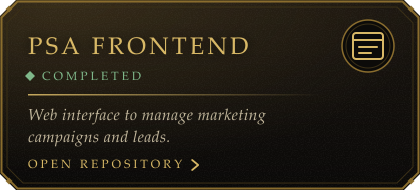
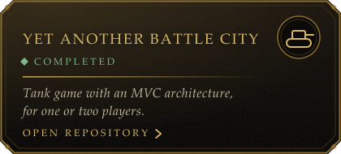
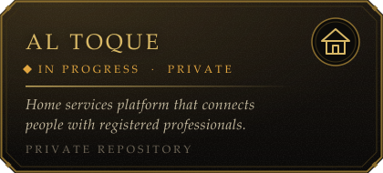
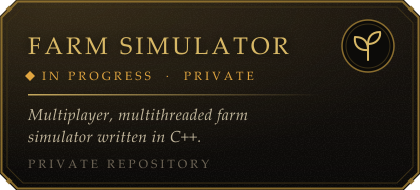

<h1 align="center"> Hi, I'm Franco Martín Alonso </h1>

<i>Computer Engineering student · Backend Developer</i>

  
  

## About me

I'm a backend developer who also designs product UI and builds it with AI tools. I write code by hand, use AI to speed up my work, and review everything I ship.

I'm a Computer Engineering student at the University of Buenos Aires (FIUBA), currently in my fourth year. I enjoy solving complex problems, designing clean APIs and building reliable, maintainable software. Outside tech, I love developing and playing video games, especially the Souls series.

🎓 Computer Engineering at FIUBA (UBA), 4th year &nbsp;·&nbsp; 📍 Buenos Aires, Argentina &nbsp;·&nbsp; 🎮 Souls series fan

## Projects

  
  
  
  
  
  

## Skills

<h4 align="center"> Languages </h4>

  
  
  
  
  

<h4 align="center"> Backend </h4>

  
  
  
  
  

<h4 align="center"> Frontend </h4>

  
  
  
  

<h4 align="center"> Databases, Tools and Technologies </h4>

  
  
  
  
  

  
   
  Let's talk: <a href="https://www.linkedin.com/in/franco-martin-alonso/">LinkedIn</a> · <a href="mailto:04francomartin@gmail.com">04francomartin@gmail.com</a>

