<h1 align="center"> <b>Hi, I'm Franco Martín Alonso</b> </h1>
<!--  -->

***About me***

I am a Computer Engineering student at the University of Buenos Aires (FIUBA), currently in my fourth year. I design and develop backend systems, from architecture to production, and I also love developing video games. I enjoy solving complex problems, designing clean APIs and building reliable, maintainable software.
- 🔧 I’m currently working on
  - **Tallio**: a desktop management system for auto repair shops
  - A multiplayer, multithreaded farm simulator in C++
  - **Al Toque**: a home services platform built with Spring Boot
- 🧠 I write code by hand and also use Spec-Driven Development with AI coding agents to speed up my workflow, reviewing everything I ship.
- ✔ Ask me about anything, I am happy to help 
- Outside tech, 🎮 I love developing and playing video games.
- 🌐 Check out my work at my <a href="https://martinalonso333.github.io">portfolio</a>
- 💼 Connect with me on <a href="https://www.linkedin.com/in/franco-martin-alonso/">LinkedIn</a>
- 📫 Reach out to me at: <a href="mailto:04francomartin@gmail.com">04francomartin@gmail.com</a>

## My Skills Include

<h4> Languages </h4>

  
  
  
  
  

<h4> Backend </h4>

  
  
  
  
  

<h4> Frontend </h4>

  
  
  
  

<h4> Databases, Tools and Technologies </h4>

  
  
  
  
  

## Check out my Work

